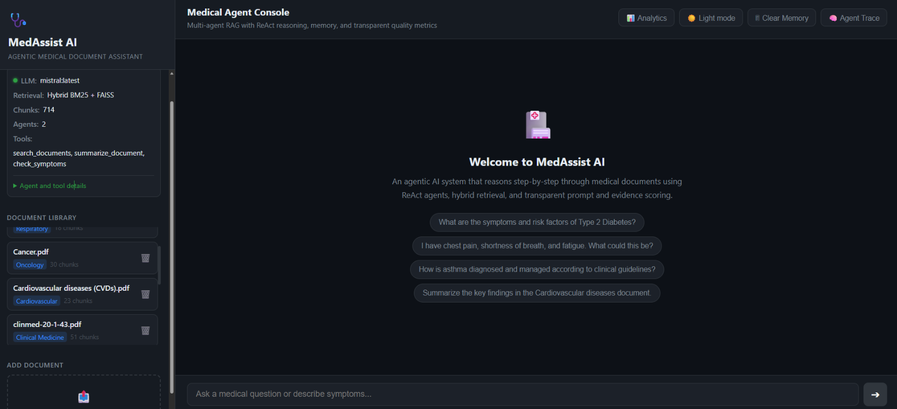
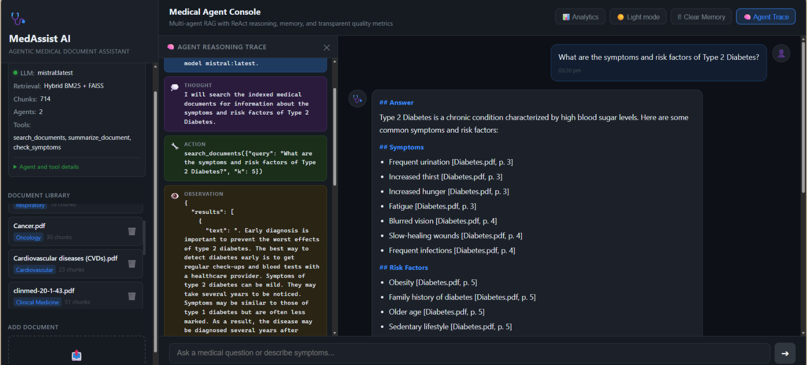
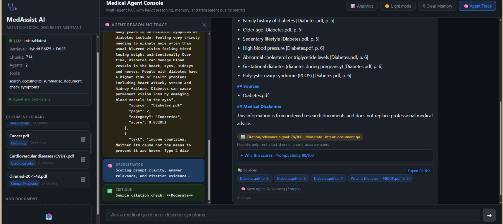
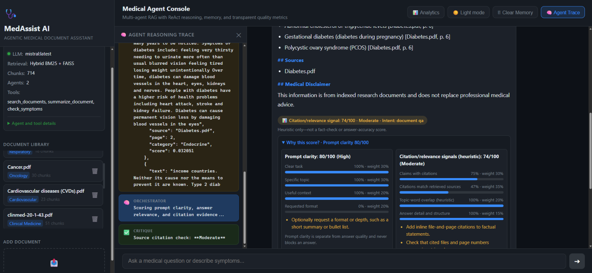

# MedAssist AI: Agentic Medical Document Assistant

[](https://github.com/priyankakamalanathan03-create/medassist-ai-agentic-medical-rag/actions/workflows/ci.yml)

**A multi-agent medical document assistant using hybrid retrieval and retrieval-augmented generation.**

MedAssist-AI lets users ask questions about a collection of medical PDFs. It combines lexical and dense retrieval, a bounded tool-using language-model workflow, page-level citations, and a React interface.

> **Scope and safety:** This is an educational research prototype, not a medical device or diagnostic system. Its citation and relevance indicators are heuristics, not proof of factual or clinical correctness. Do not use it to make health decisions or submit identifiable patient information.

## Features

- Hybrid retrieval with BM25, FAISS, and Reciprocal Rank Fusion (RRF).
- PDF ingestion that preserves source filename and page metadata.
- Deterministic routing to document Q&A, document summarization, or symptom-analysis workflows.
- Two bounded ReAct-style specialists with three registered tools:
  - `search_documents`
  - `summarize_document`
  - `check_symptoms`
- Streamed chat responses, sources, and agent/tool trace.
- Session-scoped conversation memory, document upload/deletion, analytics, and citation export.
- Separate prompt-clarity and citation/relevance heuristic indicators.

## Technology Stack

| Area | Technologies |
|---|---|
| Frontend | React 19, Vite, vanilla CSS, Server-Sent Events |
| Backend | Python, FastAPI, Pydantic, Uvicorn |
| Retrieval | BM25, FAISS, sentence-transformers/all-MiniLM-L6-v2, Reciprocal Rank Fusion |
| Document Processing | PyPDF, LangChain text splitters |
| Language Models | Groq cloud API with local Ollama fallback |
| Automation | GitHub Actions, Python `unittest`, ESLint, Vite build |

## Core Workflow

1. Upload or package authorized medical PDFs.
2. Extract text and preserve source filename and page metadata.
3. Index chunks using lexical and dense retrieval.
4. Classify the query as document Q&A, summarization, or symptom analysis.
5. Route the query to a bounded ReAct specialist and registered tools.
6. Stream the answer with agent/tool steps, sources, and quality indicators.

## Application Screenshots

### Figure 1 - Main Medical Agent Console



The main workspace shows the active LLM provider, hybrid retrieval mode, indexed chunk count, registered agents and tools, document library, upload area, chat console, analytics, light/dark mode, memory controls, and agent-trace panel.

### Figure 2 - ReAct Agent Trace and Retrieved Answer



This view demonstrates the visible reasoning pipeline: local Ollama fallback, specialist routing, a focused `search_documents` action, indexed document observations, streamed answer generation, and source citations.

### Figure 3 - Tool Observation and Source-Grounded Response



The agent trace exposes retrieved passages with PDF filenames and page numbers, while the chat panel presents the final answer, key points, sources, disclaimer, quality signal, and citation export control.

### Figure 4 - Prompt Clarity and Citation Quality Metrics



The detail panel separates prompt clarity from deterministic citation/relevance heuristics. It shows clear-task scoring, answer detail, source matching, topic overlap, suggestions, and an explicit notice that the metrics are not a fact-check or clinical correctness score.

## Architecture

```text
React + Vite
     │ HTTP / Server-Sent Events
     ▼
FastAPI ──► deterministic intent router
                  │
          ┌───────┴────────┐
          ▼                ▼
    RAG specialist    Symptom specialist
          │                │
          └───────┬────────┘
                  ▼
              Tool registry
          ┌───────┼──────────┐
          ▼       ▼          ▼
       Search   Summary   Symptom match
          │
          ▼
 BM25 + FAISS + RRF over indexed PDF chunks
          │
          ▼
 Groq API (primary) / local Ollama fallback ──► cited answer + trace
```

The retriever and indexes run locally. Answer generation uses Groq when configured and falls back to local Ollama when Groq is unavailable. With Ollama configured, chat can continue without an external inference request.

## Repository layout

```text
.
├── backend/
│   ├── agents/          # Orchestrator, specialists, and heuristic scorer
│   ├── api/             # Chat, upload, analytics, and citation endpoints
│   ├── llm/             # Groq client and provider error handling
│   ├── memory/          # In-memory, per-session conversation window
│   ├── rag/             # PDF indexing and hybrid retrieval
│   ├── tests/           # Backend regression tests
│   └── tools/           # Search, summary, and symptom tools
├── data/
│   ├── raw_documents/   # User-supplied PDFs; not included in this repository
│   ├── processed_documents/ # Generated indexes; not included
│   └── evaluation/      # Optional evaluation data; not included
├── docs/
│   └── images/          # Application screenshots used in this README
├── frontend/            # React 19 and Vite application
├── .github/workflows/   # Backend and frontend continuous integration
├── requirements.txt
├── start_backend.bat
└── start_frontend.bat
```

## Requirements

- Windows, macOS, or Linux
- Python 3.10 or later (developed with Python 3.10)
- Node.js and npm
- Either a Groq API key and an available model, or a running Ollama installation with a downloaded model
- Medical PDF files that you are permitted to use

## Run locally

### 1. Configure the backend

From the repository root, create a Python environment and install dependencies:

```powershell
python -m venv backend\venv
backend\venv\Scripts\Activate.ps1
pip install -r requirements.txt
```

Copy `backend/.env.example` to `backend/.env`. Configure Groq as the primary provider, or leave its key unset to use local Ollama:

```text
GROQ_API_KEY=
GROQ_MODEL=qwen/qwen3.8-27b
OLLAMA_BASE_URL=http://127.0.0.1:11434/v1
OLLAMA_MODEL=mistral:latest
```

Add your Groq key to use Groq as the primary provider. For local inference, install and start Ollama, then download the configured model with `ollama pull mistral:latest`. The backend automatically uses Ollama when Groq is blocked by TLS/network issues, unavailable, or rate-limited. Never disable TLS verification or commit/share `backend/.env`.

### 2. Add documents and build the indexes

Place PDFs you have permission to process in `data/raw_documents/`. The project repository intentionally does not distribute its medical PDFs or generated indexes.

PDF indexing uses the `sentence-transformers/all-MiniLM-L6-v2` embedding model. It is loaded from the local Hugging Face cache without making network requests; the model must be available in that cache before indexing or uploading documents.

```powershell
Set-Location backend
python -m rag.indexer
```

The indexer creates the processed documents and retrieval indexes under `data/processed_documents/`.
The backend can also start before documents are indexed; in that case, retrieval returns no results until you upload a PDF through the UI or build an index.

### 3. Start the backend

From the `backend` directory:

```powershell
python -m uvicorn main:app --reload --host 127.0.0.1 --port 8000
```

The API status endpoint is available at `http://127.0.0.1:8000/api/status`.

### 4. Start the frontend

Open a second terminal:

```powershell
Set-Location frontend
npm ci
npm run dev
```

Open `http://localhost:5173`. The frontend uses `http://127.0.0.1:8000` as its default API URL. Set `VITE_API_BASE_URL` when the backend runs elsewhere. The root-level `start_backend.bat` and `start_frontend.bat` scripts are optional Windows launch helpers.

## Validation

Run backend regression tests from `backend/`:

```powershell
python -m unittest discover -s tests -v
```

Run frontend checks from `frontend/`:

```powershell
npm run lint
npm run build
```

The repository includes an optional MedQuAD retrieval script. Its current hit-rate measure only checks whether any chunks were returned; it is **not** answer accuracy, relevance, or clinical validation. No benchmark performance is claimed here.

## Evaluation and limitations

- Citation coverage checks whether answer units contain citation text; source matching checks whether cited file/page pairs appeared in retrieved sources. Neither checks whether the passage entails the claim.
- Topic-word overlap and answer-structure metrics are deterministic heuristics, not semantic or factuality evaluations.
- The symptom tool uses a fixed keyword map. Its match label is not a diagnosis or probability.
- The document-summary tool selects representative passages; the language model synthesizes the final summary.
- Retrieval quality depends on the supplied documents, PDF text extraction, chunking, and query wording.
- The current project has not been clinically validated and must not be used for diagnosis or treatment.
- If both Groq and local Ollama are unavailable, the backend surfaces an error rather than fabricating an answer.

## Data and privacy

This repository excludes source PDFs, generated indexes, evaluation data, build outputs, and credentials. It includes only application screenshots for documentation. Add only documents that you have permission to process and redistribute where applicable. Chat analytics stores submitted query text locally; do not enter identifiable patient data.
